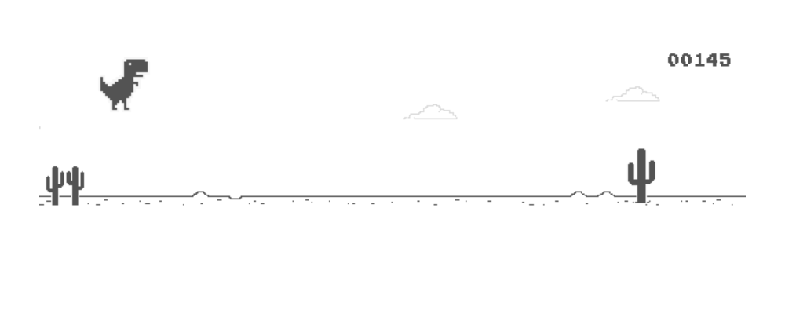

# Dino — NEAT-агент для Chrome Dino

Обученный агент для игры **T-Rex Runner**, который уверенно проходит **15500+ очков**.



## Быстрый запуск

### Windows — двойной клик

Открой `START_DINO.bat`. Откроется окно браузера с игрой.

### Из терминала

```powershell
python play_neat.py
```

Если `python` не настроен, используй:

```powershell
py play_neat.py
```

## Управление

| Клавиша | Действие |
|---|---|
| `Space` | Начать забег; во время забега — прыжок |
| `ArrowDown` | Присесть (пока держишь) |
| `Ctrl+C` | Остановить программу |

Старт делается вручную, как в оригинальной игре: появится надпись
**Press Space to start**. Дальше динозавр управляется NEAT-моделью.
Если нажать клавишу во время забега, динозавр отреагирует на неё в этом кадре.
Сама модель при этом не меняется: веса не перезаписываются, обучение не запускается,
внутреннего состояния у сети нет.

Чтобы получить результат **15500+**, просто не нажимай клавиши после старта и дай
агенту бежать: примерно за 14–17 минут он проходит 15500–19000 очков.

## Результат

| Кадров | Очки |
|---:|---:|
| 8 000 | 1 987 |
| 30 000 | 9 138 |
| 60 000 | 18 889 |
| 120 000 | 38 390 |

Чемпион детерминирован: он всегда использует один и тот же seed препятствий,
поэтому результат воспроизводится от запуска к запуску.

## Как это работает

- `game/` — локальная копияoriginal T-Rex Runner, чтобы не зависеть от интернета.
- `game/eval_bridge.js` — мост между игрой и агентом:
  - виртуальные часы, один шаг = один кадр;
  - фиксированный `Math.random` для воспроизводимости;
  - отключённый таймер ресайза игры, который мешал длинным эпизодам;
  - реальные нажатия клавиш пользователя приоритетнее действия сети на один кадр.
- `fast_dino_env.py` / `fast_dino_env_async.py` — обёртки над игровой страницей.
- `champion.pkl` — сохранённый геном NEAT (45 входов, 3 выхода).
- `neat_config.cfg` — конфигурация NEAT для этого генома.
- `train_neat.py` — опциональный тренажёр: 15 параллельных страниц в одном Chromium.

## Обучение заново (не обязательно)

```powershell
python train_neat.py
```

Обучение пишет `champion.pkl` и чекпоинты `neat-checkpoint-*`; чекпоинты в репозиторий
не включены. Для нормальной работы достаточно готового `champion.pkl`.

## Установка

```powershell
python -m pip install -r requirements.txt
python -m playwright install chromium
```

## Структура

```text
START_DINO.bat          запуск двойным щелчком
play_neat.py            просмотр чемпиона
train_neat.py           обучение NEAT
fast_dino_env.py        синхронная обёртка
fast_dino_env_async.py  асинхронная обёртка
champion.pkl            обученный геном
neat_config.cfg         конфиг NEAT
game/                   игра + eval_bridge.js
requirements.txt
```

## Благодарности

Chrome Dino — Chromium Authors. Публичная версия игры —
[wayou/t-rex-runner](https://github.com/wayou/t-rex-runner).

Лицензия: MIT. См. `LICENSE`.
